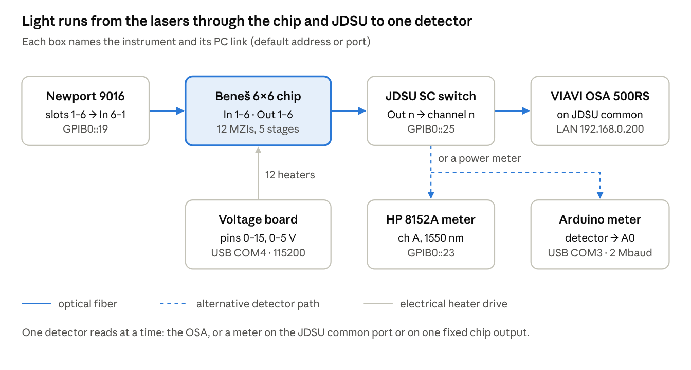
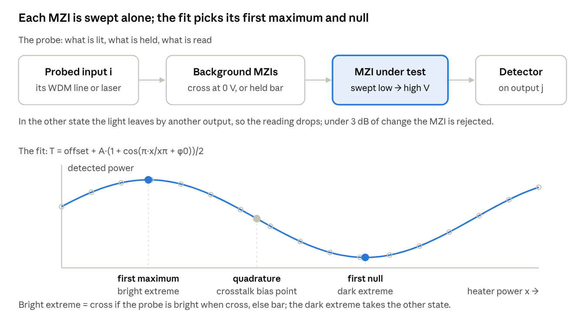
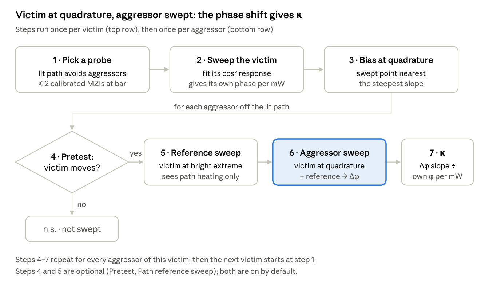
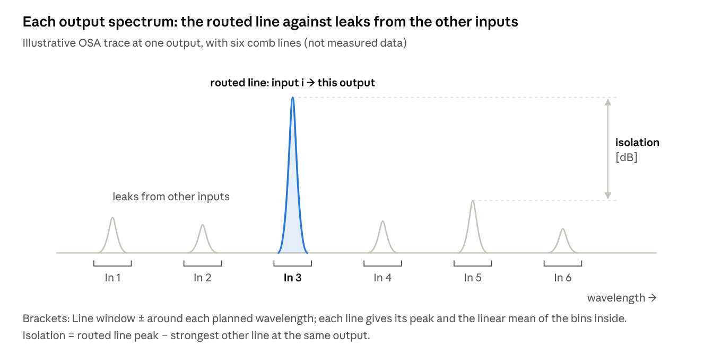

# BenesController — User Guide

## Overview

BenesController is a Tkinter desktop app that drives a 6×6 Beneš switch chip: 12 thermo-optic 2×2 MZIs in five stages, enough to route all 720 input→output permutations. It sets heater voltages, reads light back through an OSA or power meters, and runs calibration, crosstalk, WDM and impulse measurements, saving everything under `Results/` or a linked dataset folder.

The code is split in four layers:

| Package | What it holds |
| --- | --- |
| `benes/core` | Network topology, route solver, heater current-density limits |
| `benes/hardware` | Drivers: voltage board, Arduino meter, HP 8152A, VIAVI OSA, JDSU switch, Newport 9016 lasers |
| `benes/measurements` | Scans, MZI probing and fitting, crosstalk matrix, WDM comb evaluation, impulse capture, datasets, CSV export |
| `benes/gui` | One mixin per tab or dialog, combined into `BenesApp` in `app.py` |

Every setting persists in a `benes_*_config.json` file beside the app (or beside the exe when frozen). A dry-run or simulated mode exists for every instrument, so the whole workflow can be rehearsed without hardware.

## Hardware setup and connections

Six instruments talk to the PC; the chip itself has no PC link and is reached only through light and the voltage board. The optical chain is always lasers → chip → JDSU → detector.



The JDSU switch is what makes every output reachable from a single detector: closing channel *n* sends chip output *n* to the common port.

| Instrument | Role | PC link (default) | Set up in | Saved in |
| --- | --- | --- | --- | --- |
| Voltage board (`../VoltageTuner/board.py`) | Drives the 12 heaters with `DC <pin> <voltage>` | USB serial, COM4, 115200 baud | Hardware & OSA → Voltage board | `benes_voltage_config.json` |
| VIAVI OSA 500RS | Reads trace 1 spectra | TCP 192.168.0.200:8002 | Hardware & OSA → OSA & output switch | — |
| JDSU SC optical switch | Picks which chip output reaches the detector | GPIB0::25::INSTR, SC command set, CR+LF | OSA & output switch → Selector setup… | `benes_osa_output_switch_config.json` |
| HP 8152A power meter | Triggered power readings for calibration and crosstalk | GPIB0::23::INSTR, channel A, 1550 nm, autorange | Hardware & OSA → HP 8152A meter | `benes_hp8152a_config.json` |
| Arduino Uno + detector | Raw A0 optical stream for calibration and impulse tests | USB serial, COM3, 2,000,000 baud, Stream: raw | Hardware & OSA → Arduino meter | `benes_power_meter_config.json` |
| Newport 9016 laser bank | One laser per chip input | GPIB0::19::INSTR | Newport lasers tab; slot map in MZI calibration | `benes_laser_bank_config.json` |

Wiring checklist:

1. Patch the six chip outputs to JDSU channels 1–6 (default map: output *n* → channel *n*) and the JDSU common port to the OSA.
2. Patch the Newport slots to the chip inputs. The default map is reversed: slot 1 feeds input 6, slot 6 feeds input 1.
3. Wire the voltage-board pins to the heaters, then assign them in **MZI ↔ pin mapping / calibration…**. Keep pin 8 free only if you still use the legacy dual-channel impulse sketch.
4. For the Arduino meter, upload `ArduinoOptical/ArduinoOptical.ino` and connect the detector's analog output to A0. Keep it within 0–5 V.
5. For power-meter detection, put the HP 8152A or the Arduino detector on the JDSU common port (any output) or on one fixed output.

## Installation and launch

The app runs on Python 3.10+ from the project folder with `python benes_gui.py` (or `python -m benes`). The GUI itself needs only the standard library; each instrument adds a dependency.

| Need | Install | Used by |
| --- | --- | --- |
| Plots | `python -m pip install matplotlib` | Spectra, sweeps, crosstalk, impulse plots |
| GPIB instruments | NI-VISA + `python -m pip install pyvisa` | JDSU, HP 8152A, Newport 9016 |
| Serial devices | `pyserial` | Voltage board, Arduino meter |
| Impulse test | `numpy` | Impulse trace processing |

The app also loads two helpers from sibling folders, so keep this layout:

```
python/
  BenesController/     this app, configs, Results/
  VoltageTuner/        board.py (voltage-board serial protocol)
  ThorlabsControl/     ArduinoSampler.py (Arduino stream reader)
```

To build a standalone exe, run `rebuilder_interactive.bat` (PyInstaller). The frozen app bundles both helpers and keeps its configs and `Results/` beside the exe.

To check the topology, solver and drivers without hardware, run `python -m unittest -v`.

## GUI tour

The window has seven tabs, ordered by workflow, and a status strip under the title that names the running step and shows its progress on every tab.

| Tab | What you do there | Key controls |
| --- | --- | --- |
| Routing | Pick routes, set MZI states, route full permutations, evaluate a configuration | Route explorer diagram, **X / = / 0** per MZI, **Route permutation**, **Shuffle**, **Apply path (drive bar/cross)**, **Evaluate Configuration** |
| Hardware & OSA | Connect instruments; sub-tabs Voltage board, OSA & output switch, Arduino meter, HP 8152A meter | **Connect**, **Dry run**, **Simulate**, **Selector setup…**, **Route + read**, **Read all outputs**, **Start stream**, **MZI ↔ pin mapping / calibration…** |
| MZI calibration | Find each MZI's bar and cross voltages; check states | **Detection**, **Sweep selected MZI**, **Calibrate all visible MZIs**, **Alignment check (all 0 V)**, **Check routed states**, **Detect six lasers** |
| Thermal crosstalk | Manual voltage scans per switch and the automatic κ matrix | **Scan selected switches**, **Plan**, **Run matrix**, **X axis**, **Open results…** |
| Dataset coverage | Link a dataset folder, save acquisitions, run batch scans, see coverage | **Initialize full 720-permutation set**, **Save six-laser configuration**, **Run all 720 output permutations**, **Run all 4096 switch states**, **Analyse** |
| Impulse test | Drive one MZI with a pulse or square wave and record the optical response | **Single pulse**, **Play square wave**, **Export trace CSV** |
| Newport lasers | Set laser current and TEC temperature per slot | **Set**, **Turn ON / OFF**, **ALL CURRENT OFF**, **Detach** |

### Route explorer (Routing tab)

- Click an **input** to see its path and current output. Thin dashes in the same colour show where crosstalk could leak from each switch's unused port.
- Click an **output** too to list every physical path between the two ports; **=** is bar (straight), **X** is cross.
- **Apply path** drives only that path's MZIs. With **Keep complete output permutation** on, it changes the fewest MZIs while keeping every other connection.
- Type six outputs and press **Route permutation** to set all six connections at once. **Equivalent full-network routings** lists every switch state that gives the same permutation.
- Clicking an MZI cycles cross → bar → 0 V. Cross and bar send the calibrated voltages; 0 V is drawn amber and routes as cross, the chip's unbiased state.
- Coloured rings mark the outputs where the **Power Meter** and **OSA** sit; they are saved with every scan.

### Heater safety limits

Every voltage sent to the board is checked against the heater's current density, set per pin in the mapping dialog (**R heater**, **R total**, **J peak/V**, or **Import heater CSV…**).

- At $50\ \mathrm{mA/\mu m^2}$ (safe limit) the app asks for confirmation once per switch and voltage.
- At $70\ \mathrm{mA/\mu m^2}$ (break limit) the voltage is always refused.
- Without J peak/V, only the 0–5 V confirmation applies. Scans check their whole voltage list before they start.

## MZI calibration

Calibration finds each MZI's bar and cross voltages, which every later route, scan and check sends. Each MZI is swept with a *probe*: one lit input, one read output, and every other MZI in a fixed state, so the light reaches that output in only one of the swept MZI's states.



Uncalibrated MZIs stay cross at 0 V. Once an MZI is calibrated, later probes may hold it at bar so the detector can see further, which is why calibration runs in rounds.

### Choose a detection method

| | OSA · all lasers on | Power meter · one laser at a time |
| --- | --- | --- |
| How inputs are told apart | Each input carries its own WDM line | The Newport bank lights one input at a time |
| Detector | OSA behind the JDSU | HP 8152A or Arduino, on the JDSU common or a fixed output |
| Reference | The line that arrives in the other state | None |
| Speed | Slow: one OSA read per point | Much faster |
| Visible MZIs | All 12 at 0 V | All 12 through the JDSU; 8–10 from a fixed output |
| Needs first | A six-wavelength plan (**Detect six lasers**) | All mapped TECs on, slot map, **Laser settle [s]** |

### Run it

1. Map pins and heater resistances in **MZI ↔ pin mapping / calibration…** and save.
2. Initialize a dataset in **Dataset coverage**; calibration runs are saved in its `calibration/` folder.
3. Pick the **Detection** method. The **Probe** column then shows how each MZI will be read, for example `In 1 → Out 5, bright when cross; S2.1 at bar`, or where to move the detector if it cannot be seen.
4. Set the low and high voltage, step and settle time.
5. Press **Sweep selected MZI**, check its plot, then **Save the voltages found**. Or press **Calibrate all visible MZIs** to run every round, grouped by input and output so lasers and the JDSU move as little as possible.
6. With the OSA method, tick **Then check all-cross and all-bar** to verify the result.

### What is evaluated

Each sweep is fitted against heater drive $x$:

$$
T(x) = \text{offset} + A\,\frac{1 + \cos\left(\pi x / x_\pi + \varphi_0\right)}{2}
$$

- $x$ is heater power in mW, $x = I^2 R_\text{heater}$ with $I = V / R_\text{total}$, or $x = V^2$ when the resistance is unknown.
- Good fit (RMS under 5% of $A$): cross and bar are the measured points nearest the first maximum and first null. A sweep past $2\pi$ never picks the second extreme.
- Poor fit: the extremes come from the data, the two-line contrast for the OSA or the power for a meter. Points within 2% of the swing resolve to the lowest voltage.
- Fewer than 3 dB of change rejects the MZI; usually the wrong input is lit or the detector is on the wrong output.
- Every MZI returns to 0 V at the end, also after **Stop** or an error.

Files: `mzi_calibration.json` (probe, voltages, extinction, fit per MZI), `mzi_sweeps.csv`, and one plot per MZI.

### State checks

**Alignment check (all 0 V)** and **Check routed states** read all outputs with all lasers on. For every MZI the margin is the expected line minus the other line at its outputs: **State OK** at or above the **Pass margin**, **wrong state** when the lines are swapped by that much. They save `state_checks.json`, `output_readouts.csv` and `readout_spectra.csv`.

**Detect six lasers (1550–1560 nm)** finds six peaks on the OSA and writes them into the WDM plan: the longest wavelength goes to input 1, the shortest to input 6.

## Thermal crosstalk matrix

The automatic matrix measures $\kappa$ for each aggressor–victim pair: the share of the aggressor's heater power that the victim MZI effectively feels. It needs calibrated MZIs and reuses the detection method from the MZI calibration tab and the voltage limits, step and settle time of the manual scan.



### What is evaluated

1. **Path correction.** The aggressor also warms the other MZIs on the lit path. With the victim at its bright extreme it is insensitive to phase, so the reference sweep sees only that path change, and the quadrature sweep is divided by it:

   $$
   P'(x) = P(x)\,\frac{P_\text{ref}(0)}{P_\text{ref}(x)}
   $$

2. **Phase shift.** The victim's fitted cos² is inverted on the branch where the bias sits, turning $P'$ into $\Delta\varphi$ from the first point. It stays valid while the victim remains within $\pm\pi/2$ of quadrature.
3. **κ.** A straight-line fit of $\Delta\varphi$ against aggressor heater power gives a slope, divided by the victim's own phase per heater power ($\pi / x_\pi$ from step 2):

$$
\kappa = \frac{d\Delta\varphi_\text{victim} / dP_\text{aggressor}}{d\varphi_\text{victim} / dP_\text{victim}}
$$

$\kappa$ is reported only when both heaters have resistances, or both have none, so both drives are in the same unit.

### Options

| Option | Default | Effect |
| --- | --- | --- |
| **Path reference sweep (victim bright)** | On | Removes path heating; doubles the aggressor sweeps |
| **Adjacent MZIs only (same or next stage)** | On | Pairs more than one stage apart are left out as negligible |
| **Pretest: skip aggressors that do not move the victim** | On | Swings the aggressor low-high-high-low twice at quadrature, so linear drift cancels |
| **Min. victim shift [mrad]** | 20 | A pretest step must beat this and $4\sigma$ of the readings, or the pair is marked n.s. and not swept |

### Run it

1. Calibrate the MZIs first; probes may hold up to two calibrated MZIs at bar.
2. Select **Aggressors** and **Victims** (all 12 by default) and press **Plan**. A pair is unmeasurable when every probe of the victim passes through the aggressor, since the aggressor would switch the light itself.
3. Press **Run matrix**. A live κ heatmap fills in, with one tab per victim showing its fit, bias and phase-shift curves.

Results go to `Results/Crosstalk_matrix/<time>_matrix/`: `crosstalk_matrix.json`, `crosstalk_matrix.csv` (κ, aggressor rows × victim columns), `crosstalk_sweeps.csv`, the heatmap and one plot per victim.

### Manual voltage scan

The upper part of the tab sweeps selected switches one by one and plots the detector response.

1. In **Route explorer**, choose the input and output, and mark the **Power Meter** and **OSA** ports.
2. Select switches (Ctrl/Shift), choose **HP 8152A** or **OSA**, set limits, step and settle, add a **Scan comment**.
3. Optionally press **Test reading and GPIB read rate** (12 triggered readings). The HP filter is 8 Hz off / 2 Hz on, so GPIB rate is not optical bandwidth.
4. Press **Scan selected switches**. Each switch returns to 0 V after its sweep, also on failure.

The HP reading is a triggered dBm value; the OSA gives peak and window-mean power per voltage (linear mean, shown in dBm). **X axis** switches the plots between volts and heater power. Each run saves `base_setting.json`, `base_path.png`, one PNG per switch and `crosstalk_dataset.csv` under `Results/Crosstalk_scan/Port{in}-Port{out}_{time}/`. **Open results…** replots any saved scan.

## Measurement workflows

Three workflows use a routed chip: WDM configuration evaluation (does each wavelength reach its port, and how much leaks), dataset acquisition (which permutations are measured), and the impulse test (how fast an MZI responds).

### WDM configuration evaluation

Every input carries its own comb line, so one OSA trace per output shows the routed signal and the leakage of all other inputs at once.

1. In **Dataset coverage → Six-laser OSA scan configuration**, set **Comb lines [nm]** (or use **Detect six lasers**), **Line window ± [nm]**, **OSA/JDSU settling [s]** and **Evaluate sweeps per output** (1–16, default 10). Press **Save six-laser configuration**.
2. Route a permutation on the Routing tab.
3. Press **Evaluate Configuration**. The JDSU steps through all six outputs; each output waits the settling delay and averages the sweeps in linear power.



Per wavelength $\lambda_i$ (input $i$, expected output $e$), with $P_{i,o}$ the line's peak power at output $o$ in linear mW, the evaluation table reports:

| Quantity | Definition |
| --- | --- |
| Total power [dBm] | $P_\text{tot} = \sum_{o=1}^{6} P_{i,o}$ |
| Transmission [dBm] | $P_{i,e}$, the line's peak at its expected (routed) output |
| Transmission ratio [dB] | $10\log_{10}\left(P_{i,e} / P_\text{tot}\right)$ |
| Crosstalk ratio [dB] | $10\log_{10}\left(P_{i,o} / P_\text{tot}\right)$ for each other output $o \neq e$ |

Per output, the isolation is the routed line's peak minus the strongest other line there, in dB.

The settling delay should cover the switch and at least one full OSA sweep, so no trace holds light from the previous output. More sweeps reduce noise but cannot correct a shifted coupling mean.

Each scan writes `Results/WDM_scan/<timestamp>/`: `wdm_summary.csv` (one row per output), `wdm_line_matrix.csv` (every input's line peak at every output), `wdm_spectra.csv` and `wdm_scan.json` (permutation, plan, delays, JDSU map, switch states, voltages). **Export image, controls and data to results** adds the plot, the table and the control voltages.

### Dataset coverage

A dataset folder records which routed input→output pairs have been measured for each permutation.

1. **Choose folder…**, then **Initialize full 720-permutation set** or **Initialize active permutation only**.
2. Acquire: **Route + read** / **Read all outputs** for the OSA, or **Read current power** for the Arduino.
3. Select the **Inputs** and **Outputs** the reading represents, add a comment, and press **Save latest acquisition**. Each record gets its own folder under `Measurements/` with the raw CSV and a `measurement.json` sidecar.
4. Press **Analyse** to list missing pairs; the full list goes to `coverage_report.csv`.

For batch runs use **Scan active control state**, **Run all 720 output permutations**, or **Run all 4096 switch states** (every bar/cross combination of the 12 MZIs, $2^{12}$). **Stop after current output** keeps completed configurations, and the original control state is restored at the end.

### Impulse test

The impulse test drives one MZI with a voltage step and records the Arduino A0 stream, to see the thermo-optic response time.

1. Connect the voltage board and the Arduino meter (**Stream: raw**).
2. Pick the MZI and set low and high voltages (0–5 V).
3. Choose **Single pulse** (pulse length, total duration, **Lead-in** baseline) or **Play square wave** (**Period**, **High time**). Times are in seconds and accept `1e-3` for 1 ms.
4. **Stop** ends a square wave and returns the MZI to the low voltage. **Export trace CSV** saves raw A0 samples, jump flags and commanded voltages.

The second plot line is the *commanded* voltage, not a measurement. The sketch has no sample clock, so the sample period is the recording time divided by the frames received; edge times are host estimates with Windows scheduling jitter. A trace holds at most 2,000,000 samples.

## Typical session, files and troubleshooting

A full session goes from connecting the instruments to a calibrated chip that can be routed and measured. Later sessions can skip the mapping and recalibrate only when the alignment check fails.

1. **Connect.** In Hardware & OSA, connect the voltage board (it sends every saved voltage on connect), the OSA, and the meters you need. The JDSU connects automatically at startup. In Newport lasers, turn on the TECs and the lasers.
2. **Map.** In **MZI ↔ pin mapping / calibration…**, assign pins and heater values, then save.
3. **Dataset.** In Dataset coverage, choose and initialize a dataset folder.
4. **Wavelengths.** Press **Detect six lasers**, or type the comb lines, then **Save six-laser configuration**.
5. **Check alignment.** Run **Alignment check (all 0 V)** to see whether every MZI is in its unbiased state.
6. **Calibrate.** Run **Calibrate all visible MZIs**, then the all-cross and all-bar checks.
7. **Crosstalk (optional).** **Plan** and **Run matrix** in Thermal crosstalk.
8. **Measure.** Route permutations and press **Evaluate Configuration**, or run a dataset batch.
9. **Speed (optional).** Run the impulse test on one MZI.

To rehearse without hardware, use a dry-run voltage board, OSA **Simulate** and a dry-run JDSU (**Selector setup…**). A simulated chip answers, with cos² MZIs, switchable lasers and thermal crosstalk between neighbouring heaters.

### Where results go

| Location | Written by | Contents |
| --- | --- | --- |
| `benes_*_config.json` | Every settings change | Pin map, voltages, calibration, instrument settings, WDM plan, laser slots |
| `<dataset>/calibration/` | MZI calibration and state checks | `mzi_calibration.json`, `mzi_sweeps.csv`, plots, `state_checks.json`, `output_readouts.csv`, `readout_spectra.csv` |
| `<dataset>/Measurements/` | **Save latest acquisition**, batch runs | Raw CSV + `measurement.json` per record |
| `<dataset>/coverage_report.csv` | **Analyse** | Missing pairs for every expected permutation |
| `Results/WDM_scan/<timestamp>/` | **Evaluate Configuration** | Summary, line matrix, spectra, scan context |
| `Results/Crosstalk_scan/Port{in}-Port{out}_{time}/` | Manual crosstalk scan | `base_setting.json`, `base_path.png`, plots, `crosstalk_dataset.csv` |
| `Results/Path_calibration/` | Automatic path calibration | Same layout as a crosstalk scan |
| `Results/Crosstalk_matrix/<time>_matrix/` | **Run matrix** | κ JSON and CSV, sweeps, heatmap, per-victim plots |

### Troubleshooting

| Symptom | Likely cause | What to do |
| --- | --- | --- |
| "only X dB change at output n" during calibration | Wrong input lit, or the detector is on the wrong output | Check the **Probe** column, the laser slot map and the JDSU channel map |
| Calibration will not start | No initialized dataset, or (meter method) a mapped TEC is off | Initialize a dataset; turn on every mapped TEC |
| A voltage is refused | It reaches the 70 mA/µm² break limit | Lower the scan limit; check **J peak/V** for that pin |
| A confirmation prompt appears | Above the 50 mA/µm² safe limit, or outside 0–5 V | Confirm once, or lower the voltage |
| A trace shows light from the previous output | Settling too short for the OSA sweep | Raise **OSA/JDSU settling** to cover one full sweep |
| Arduino read fails with no clean samples | Every sample flagged as a jump or above **Ceiling [ADC]** (80) | Reduce optical power or check the detector range; adjust **Jump guard [ms]** |
| Crosstalk meter test or scan will not start | The HP 8152A stream is running | Press **Stop** on the HP 8152A page |
| A κ cell is empty or n.s. | Pair unmeasurable, pretest saw no movement, or only one heater has resistances | Read the **Plan** output; enter both heaters' resistances |
| The window will not close | A scan, calibration or stream is still running | Stop it and wait for every MZI to return to 0 V |
